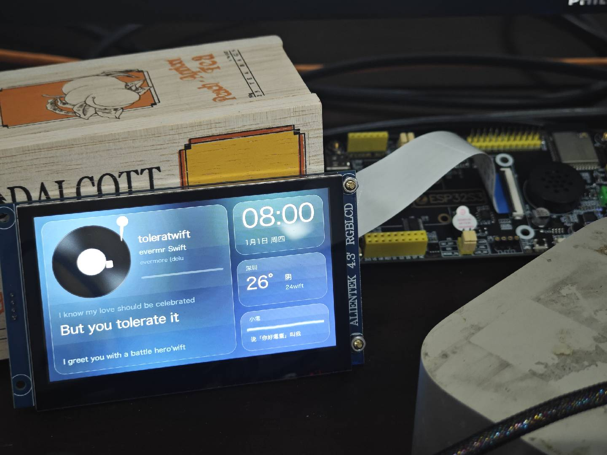

# 🐱 一天 Vibe Coding 一块桌面黑胶仪表盘：ESP32-S3 + RGB 屏实战复盘

> 一份和 AI 结对做硬件项目的过程记录。
> 从"屏幕背光亮了，帮我点亮它"开始，到一块能转黑胶、滚歌词、看天气、喊一声「你好耄耋」就会回话的桌面小屏，
> 中间踩过的每个坑、每次误判、每个最终定位到的根因，都按时间顺序写在这里。

作者：某不知名小厂的全栈开发。

[查看仪表盘源码](https://github.com/ivy987654/esp32) · [下载指南](https://github.com/ivy987654/vibe-coding-guide/releases)



这张照片记录了调试阶段的实物效果，文中按阶段整理了后续改动。

配套的 [`SKILL.md`](./SKILL.md) 把这些经验提炼成了一份可复用的技能文件，可以直接丢给你的 AI 编程助手（Claude Code / Cursor / Codex 等），让它下次做类似项目时少走弯路。

---

## 目录

- [项目最终形态](#项目最终形态)
- [硬件与工具](#硬件与工具)
- [什么是这里说的 Vibe Coding](#什么是这里说的-vibe-coding)
- [开发全过程（按时间线）](#开发全过程按时间线)
- [踩坑总表](#踩坑总表)
- [协作心得：人负责什么，AI 负责什么](#协作心得人负责什么ai-负责什么)
- [安全与发布注意事项](#安全与发布注意事项)
- [致谢](#致谢)

---

## 项目最终形态

一块 4.3 寸触摸屏常驻桌面，莫兰迪纯色卡片布局：

- **黑胶唱片**：网易云正在播放的专辑封面贴在唱片中心旋转，下面是歌名 / 歌手 / 专辑、进度条，以及三行同步歌词
- **时间卡**：由电脑对时，断开后板子自己走
- **天气卡**：城市、温度、天气、温差
- **小耄（AI 猫猫助手）**：一根会随音量和情绪起伏的波形线；说「你好耄耋」唤醒，支持连续对话和打断，回复文字显示在卡片上，声音由电脑朗读

架构一句话：**ESP32 只管显示和触摸，所有重活都在 Mac 上的一个 Python 脚本里做，再通过 USB 串口推给板子。**

```
Mac (dashboard.py)                              ESP32-S3
 ├ 正在播放 / 网易云歌词 / 封面 ─┐
 ├ 天气 API                     ├─ USB 串口 115200 ──▶ UART 接收任务 ─▶ 状态快照 ─▶ LVGL 界面
 ├ 麦克风 → VAD → 离线 ASR      │  一行一帧 + 长度校验        (core 1)                800×480 RGB
 └ 唤醒词 → 大模型 → TTS 朗读 ──┘                                       GT9xxx 触摸 ─┘
```

## 硬件与工具

| 项 | 内容 |
| --- | --- |
| 主控 | 正点原子 **DNESP32S3**（ESP32-S3，N16R8：16MB Flash + 8MB 八线 PSRAM） |
| 屏幕 | 正点原子 **ATK-MD0430R** 4.3 寸 RGB 屏，800×480，16 位 RGB565 并口 |
| 触摸 | GT9xxx 电容触摸（I2C） |
| 连接 | 板载 CH340 USB 转串口（UART0），供电 + 数据一根线 |
| 固件 | PlatformIO + ESP-IDF + LVGL 9 |
| 电脑端 | macOS + Python（用 `uv` 管依赖）+ 网易云音乐 |
| AI 助手 | Claude Code，通过远程会话直接在用户的 Mac 上读写文件、编译、烧录、读串口 |

## 什么是这里说的 Vibe Coding

整个项目里，人几乎没写一行代码，做的事情只有：

1. **提需求**：用口语描述想要的效果，甚至是语音输入带错字的那种
2. **当眼睛**：AI 看不到屏幕，人拍照或描述屏幕上的样子
3. **做 AI 做不了的物理操作**：插线、按 BOOT 键、给终端开权限、在终端里跑一行命令
4. **拍板**：方案有分歧时做选择（比如麦克风用哪个）

AI 负责：查资料（官方例程引脚、开源项目做法）、写固件和脚本、编译、烧录、读串口日志、定位根因。

关键体会：**人是 AI 的传感器，AI 是人的手。** 反馈越具体（"横向撕裂"而不是"闪"，"歌词前面多了 28800"而不是"乱码"），AI 定位得越快。

---

## 开发全过程（按时间线）

### 阶段 0：点亮屏幕，先跑通一张图

**需求**：「我已经把它连到电脑上了，背光已经亮了，用最快的方式点亮屏幕，显示一张耄耋。」

**做法**：AI 找到正点原子官方 RGB LCD 例程，抄引脚和时序，用 PlatformIO + ESP-IDF 建工程，生成一张猫图转成 RGB565 数组编进固件。

**坑 1：编译警告被当成错误**
官方驱动 `ltdc.c` 里有 `sx < 0 || sy < 0` 这种对无符号数的比较，新版编译器开了 `-Werror=type-limits` 直接报错。
👉 解决：对第三方驱动目录加 `-Wno-error`，别去改人家源码里的每一个警告。

**坑 2：烧录在 921600 波特率下失败**
esptool 能连上芯片，切到 921600 后报 `Unable to verify flash chip connection (No more data to read from the serial port)`。CH340 + 这块板的走线扛不住高波特率。
👉 解决：`platformio.ini` 里 `upload_speed = 115200`。慢，但稳。固件大到几 MB 时要多等几分钟。

**坑 3：AI 的本地权限被拦**
远程会话里的自动权限检查不让 AI 直接跑编译（因为驱动来自外部仓库）。
👉 解决：AI 把命令整理成**一行**给人复制粘贴：`cd ~/esp32/rgb && pio run -t upload`。卡在 `Connecting...` 时按住 BOOT、点一下 RESET。

> 💡 经验：第一步永远是"最小可见结果"。先让屏幕出一张图，证明引脚、时序、PSRAM、烧录链路全通，再谈功能。

### 阶段 1：转向——从播放 GIF 到卡片仪表盘

先做了一版"耄耋哈气"动画循环播放（GIF 拆帧成 RGB565 序列），然后需求变了：

**新需求**：卡片式仪表盘，黑胶唱片（封面旋转 + 歌名歌手 + 当前歌词）、时间、天气、最近键盘按键，点卡片进入全屏详情页。

**关键架构决策**：
- 板子上用 **LVGL** 做界面，触摸芯片 GT9xxx 的引脚同样从正点原子触摸例程里抄
- **数据全部由 Mac 提供**：Python 脚本读正在播放、取歌词、查天气、监听键盘，通过同一根 USB 串口发给板子
- 中文字体用 TinyTTF 运行时渲染内嵌的 TTF 子集，一份字体支持多档字号

> 💡 经验：ESP32 上做 UI，电脑做数据。WiFi、HTTPS、歌词解析、语音识别这些放到电脑上，固件就只剩"收数据 → 画界面"，调试难度降一个数量级。

### 阶段 2：网易云 + AI 助手「小耄」

**需求**：音乐用网易云；屏幕上加一个 AI 小机器人，听到「你好耄耋」才回应，接用户自己的大模型 API。

**做法**：
- 正在播放信息走 macOS 系统媒体接口；歌词先按"歌名 + 歌手 + 时长"匹配网易云接口，失败回退到 LRCLIB
- 大模型接口用 Anthropic 协议；**API key 只写进用户本机的 `~/.maodie.env`**，代码里只读环境变量，仓库里只放空白模板 `maodie.env.example`
- 唤醒词用离线 ASR（sherpa-onnx）+ 拼音模糊匹配，"你好猫爹""你好毛蝶"也能唤醒
- 开机自启用 macOS **launchd LaunchAgent**，崩溃自动重启

**坑 4：板载麦克风和 RGB 屏抢引脚**
用户想用板载麦克风。AI 查了正点原子录音例程，发现 ES8388 音频芯片的 I2S 引脚（IO3、9、10、14、46）和 RGB 屏数据线是**同一组**，屏幕亮着时麦克风根本没法工作，官方录音例程也是配小 SPI 屏的。
👉 解决：先用电脑麦克风；以后想板上收音，买个 INMP441 数字麦克风接到空闲 IO（IO1/2/11/12/13/38/39）。

> 💡 经验：做功能前先画一张**引脚占用表**。RGB 并口屏会吃掉 16+ 根 GPIO，板载外设很可能已经"名存实亡"。

### 阶段 3：冰块风改版，去掉键盘

**需求**（语音输入，带错字）：删掉键盘卡片，黑胶卡片扩大；整体改冰块/毛玻璃风格；参考 Dribbble 上的智能屏设计；笑脸改成一根随声音波动的线。

AI 先把带错字的需求"翻译"成具体改动清单再动手，用户确认方向即可。

### 阶段 4：「一直连不上电脑」——两个进程抢一个串口

**现象**：屏幕上只有天气能更新，歌曲一直显示"等待电脑连接"。

**排查**：AI 绕过电脑脚本，直接往串口发一组测试数据，让用户看屏幕——时间出来了，歌名却显示 `等待电脑连接A0 28800`。说明板子是好的，数据在路上被搅了。

**根因**：开机自启的脚本和用户手动在终端开的脚本**同时在写串口**，两路数据交错。短消息（时间、天气）偶尔能完整到达，长消息（歌曲）全被打乱。

👉 解决：脚本加单实例锁（`fcntl.flock`），第二个实例启动直接退出。

> 💡 经验：串口是独占资源。装了自启服务以后，**烧录前要先停服务**，手动调试前也要先停服务。

### 阶段 5：「28800 是什么？」——给串口协议加长度校验

**现象**：歌词前面多了 `28800`（如 `28800our portrait`），标题位置是截了头的歌词，时间卡一直"等待同步"。

**分析**：28800 = 8 × 3600，正是东八区时区偏移秒数，属于"对时"消息的字段。它出现在歌词里，说明串口丢了字节、几条消息粘在了一起。

👉 解决：协议改成每帧一行、Tab 分隔，结尾带 `\t#<payload 字节数>`，长度对不上的帧直接丢弃；电脑端每 10 秒整体重发一次所有状态，丢一帧也会很快自愈。串口接收任务固定到 core 1，不被 LCD 刷新抢占。

```
<类型>\t<字段1>\t<字段2>...\t#<前面内容的字节数>\n
```

> 💡 经验：**任何跨设备的文本协议，第一天就要带长度或校验**。别等乱码出现再加。

### 阶段 6：参考开源项目「小智 AI」

用户丢来 [xiaozhi-esp32](https://github.com/78/xiaozhi-esp32) 的链接。AI 读完后挑了适合本项目的三点：

1. **连续对话**：回答完自动再听 8 秒，追问不用再喊唤醒词
2. **打断**：它说话时再喊「你好耄耋」立刻闭嘴开始听
3. **情绪**：每次回复带情绪标签，波形线随之变色变节奏（开心粉色欢快、难过蓝色低缓、生气红色急促……）

同时做了：黑胶中心贴大幅专辑封面（电脑端取图缩到 96×96 RGB565，base64 分块传）、卡片底色取封面主色。

> 💡 经验：让 AI"参考某开源项目"时，要求它**说出打算借鉴哪几点、哪些不适用（及原因）**，再动手。比如小智是板上喇叭发声，但这块板喇叭也和屏幕抢引脚，所以声音仍从电脑出。

### 阶段 7：横向撕裂——双缓冲为什么更糟

**现象**：加了旋转封面后屏幕闪，用户描述为"横向撕裂"。

**第一次尝试：双缓冲 + 等 VSYNC 切换**。理论上标准做法，结果用户反馈"**更闪了**"。

**原因**：800×480×2 字节 ≈ 750KB 一帧，两帧都只能放在 PSRAM。RGB 屏的 DMA 要持续从 PSRAM 读，CPU 渲染也在读写 PSRAM，双缓冲让带宽更吃紧，屏幕 DMA 读不及就读到错位数据。

**第二次：退回单缓冲 + 降 PCLK**。像素时钟 18MHz → 16MHz，加大 bounce buffer（`LCD_W * 16`），开启错位自动复位。好转但仍有撕裂和文字重影。

**第三次：二分法验证**。AI 刷了一个"**唱片不转**"的测试版，让用户看一分钟：
- 全屏错位重影消失 → 确认大面积撕裂是旋转导致的（每帧要从 PSRAM 搬大量像素做旋转）
- 歌词下方还有一小块残影 → 另一个问题：字体笔画超出文字框，换行时框外部分没被擦掉。改成重绘时把文字区域向外扩一圈

> 💡 经验：
> - "更闪了"也是有价值的数据，说明方向错了，**立刻回退**，别在错误方向上堆修改。
> - 怀疑某个功能导致问题时，**做一个只去掉它的测试版**让人看，比读一百行代码更快。
> - ESP32-S3 + RGB 屏的瓶颈几乎总在 **PSRAM 带宽**。

### 阶段 8：真正的根因——串口接收缓冲放在 PSRAM

**现象**：加了长度校验后，字段**仍然**互相串位：歌名显示 `wift`、天气温度显示 `24wift`、偶尔冒出 `61%`、`#152f`（湿度和封面主色值）。

**排查**：AI 打开调试，把板子收到的每一条消息原样打印出来，与电脑发出的逐条对比。电脑发的完整无误，但板子上**存进缓冲区后的内容被替换了**。

**根因**：接收整行消息的缓冲区分配在 PSRAM 上，在 RGB 屏 DMA 高强度读 PSRAM 的同时，这块内存的内容被破坏。

👉 解决：接收行缓冲改为**内部 RAM 静态数组**（`static char line[2048]`），大的封面数据在电脑端拆成 768 字节的小块分帧传。复测 40 多秒内 64 条消息全部正确。

> 💡 经验：这是整个项目最值钱的一条——**ESP32-S3 驱动 RGB 屏时，串口/协议这类关键小缓冲不要放 PSRAM，放内部 RAM。** 之前的"长度校验"只是掩盖症状，逐条对比收发内容才找到真因。

### 阶段 9：封面为什么是椭圆——像素不是正方形

**现象**：花屏和串位都好了，但专辑封面看起来是横向偏宽的椭圆。

**分析**：查屏幕规格，800×480 可视区实际是 95.0×53.9 毫米。95.0/800 ÷ 53.9/480 ≈ 1.06，每个像素横向比纵向宽约 6%。按像素画的正圆，在屏上就被拉宽了。

👉 解决：唱片和封面横向收窄到 0.944 倍再画（`#define PX_ASPECT 0.944f`），旋转中心同步修正。

> 💡 经验：圆形 UI 元素看起来不圆，先查**屏幕物理尺寸 / 分辨率**，算像素宽高比，而不是怀疑图片缩放。

### 阶段 10：莫兰迪纯色 + 霞鹜文楷

**需求**：歌词行距太大、字太小；换更好看的字体（楷体）；配色改莫兰迪纯色，去掉半透明和磨砂叠加；歌手"黄霄雲"的"雲"显示成方框。

**做法**：
- 字体换成开源的**霞鹜文楷**（可商用、可再分发），字符子集补上繁体字
- 去掉所有半透明 / 渐变 / 毛玻璃层，背景和卡片都是不透明平涂色块。**这顺带减少了每帧的混合计算，对 PSRAM 带宽也更友好**
- 歌名 / 歌手 / 专辑放大到 36 / 28 / 24 号，进度条挪到唱片下方整行宽

**坑：新字体太大导致界面乱码**
换字体后屏幕上出现 `73`、`207`、`#4告诉我星辰大海雲` 这种串字段的内容。根因是字体文件太大，被复制进了 PSRAM，挤占内存导致界面异常。
👉 解决：字体直接从 Flash 映射区读取（`board_build.embed_files` 嵌入，TinyTTF 直接用指针），不再拷贝到 PSRAM，空出约 5MB。

### 阶段 11：歌词溢出与字号自适应

**现象**：长句歌词折成两行，把下一句挤出卡片底边；专辑名被截断。

👉 解决：当前句一行放得下就用 48 号大字；放不下先降到 36 号；还要两行就隐藏上一句，保证三行都在卡片内。歌手、专辑名过长时滚动显示。右侧时间、天气、小耄三栏字号整体放大一到两号。

---

## 踩坑总表

| # | 现象 | 根因 | 解决 |
| --- | --- | --- | --- |
| 1 | 官方驱动编译报错 | 新编译器 `-Werror=type-limits` | 第三方代码加 `-Wno-error` |
| 2 | 921600 烧录失败 | CH340 高波特率不稳 | `upload_speed = 115200` |
| 3 | 板载麦克风用不了 | ES8388 I2S 与 RGB 数据线共用引脚 | 用电脑麦克风 / 外接 INMP441 |
| 4 | 只有天气能显示 | 两个脚本同时写串口 | 脚本单实例锁；烧录前停自启服务 |
| 5 | 歌词里出现 28800 | 串口丢字节、消息粘连 | 每帧带长度校验 + 定时全量重发 |
| 6 | 旋转封面横向撕裂 | 单缓冲边扫边画 + PSRAM 带宽 | 单缓冲 + 降 PCLK + 大 bounce buffer + 减少旋转重绘 |
| 7 | 双缓冲后更闪 | 两帧都在 PSRAM，带宽更紧 | 回退单缓冲 |
| 8 | 歌词下方残影 | 字形超出文字框，重绘区域不够 | 重绘区域外扩 |
| 9 | 校验后字段仍串位 | **接收缓冲在 PSRAM 被破坏** | 缓冲改内部 RAM，大数据分块 |
| 10 | 圆形显示成椭圆 | 像素非正方形（宽约 6%） | 横向收窄到 0.944 倍 |
| 11 | 字体缺字显示方框 | 字体子集没包含繁体 | 子集加入繁体常用字 |
| 12 | 换大字体后界面乱码 | 字体被复制进 PSRAM | 字体直接从 Flash 读 |
| 13 | 长歌词溢出卡片 | 固定字号 | 按宽度自适应字号 + 隐藏上一句 |

## 协作心得：人负责什么，AI 负责什么

**给 AI 的反馈要像 bug 报告**
- ❌「屏幕闪」 → ✅「横向撕裂，封面被切成错位的几段，日期重影两行」
- ❌「乱码了」 → ✅「歌词前面多了 28800，歌名位置显示的是截头的歌词」
- 照片传不过去时，用文字描述**每个区域具体显示了什么字**

**让 AI 先说再做**
- 需求模糊（尤其语音输入）时，让 AI 先复述成改动清单
- 参考开源项目时，让 AI 列出"借鉴哪几点、哪几点不适用"
- 有多种方案时，让 AI 给推荐并说明代价，人来拍板

**允许 AI 做实验**
- "先不转唱片，看一分钟"这种测试版非常高效
- 允许 AI 直接给板子发测试数据、读串口日志，比口头描述快得多

**发现方向错了就回退**
- 双缓冲"更闪了"之后立刻回退，而不是继续加参数

**AI 做不到的事，让它给一行命令**
- 权限、物理按键、系统设置这类事，AI 应该整理成一行命令或一句清晰的操作说明

## 安全与发布注意事项

- **永远不要把 API key 发到聊天里或写进代码。** 本项目的 key 只存在用户本机 `~/.maodie.env`，仓库里只有空白模板。
- 发布到 GitHub 前，建议的 `.gitignore`：

  ```gitignore
  .pio/
  managed_components/
  build/
  *.log
  *.bin
  .env
  *.env
  !*.env.example
  main/font.ttf
  ```

- **不要发布 `font.ttf`**：如果你的字体是从 macOS 系统字体（如冬青黑体、苹方）裁剪出来的，它没有再分发授权。公开仓库请改用开源字体（霞鹜文楷、思源黑体等），并在 README 里说明如何用工具脚本自己生成子集。
- launchd 的 plist 里有本机绝对路径（`/Users/<你的用户名>/...`），发布前改成占位符。
- 发布前用 `git grep -i "key\|token\|secret\|http"` 再扫一遍。

## 致谢

- [正点原子](http://www.openedv.com/)：DNESP32S3 开发板与 RGB 屏、触摸例程
- [LVGL](https://lvgl.io/)：嵌入式界面库
- [xiaozhi-esp32](https://github.com/78/xiaozhi-esp32)：AI 助手交互设计参考
- [sherpa-onnx](https://github.com/k2-fsa/sherpa-onnx)：离线语音识别
- [霞鹜文楷 LXGW WenKai](https://github.com/lxgw/LxgwWenKai)：开源楷体
- [LRCLIB](https://lrclib.net)、网易云音乐：歌词数据
- 耄耋：精神支柱 🐱
